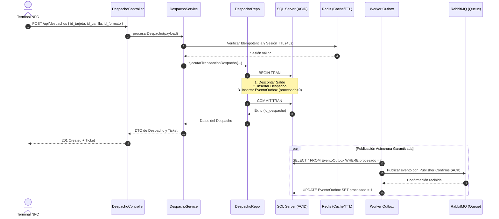

# Síntesis Teórica y Técnica: Calidad de Software (ISO/IEC 25010), Paradigmas y Arquitectura Distribuida
**Proyecto:** Sistema de Autoservicio y Despacho de Cervecería Ombú  
**Área Temática:** Paradigmas de Programación / Ingeniería de Software / Arquitectura de Sistemas  
**Rama de Implementación:** `feature/iso25010-lucrecia`  
**Autor/a:** Lucrecia Ch.

---

## 1. Introducción y Contexto del Dominio

El sistema de **Cervecería Ombú** es una plataforma distribuida de autoservicio (*Self-Service Taphouse*) diseñada para operar con terminales desatendidas (kioscos con hardware lector NFC y válvulas de grifo automatizadas).

### Desafíos Fundamentales del Dominio
1. **Concurrencia e Integridad Transaccional:** Múltiples clientes aproximan tarjetas NFC en simultáneo para servirse cerveza en distintos grifos (canillas). El débito económico sobre el saldo de la tarjeta debe ser atómico y no permitir sobregiros ni dobles cobros.
2. **Sistemas Distribuidos y el Problema de la Doble Escritura (*Dual-Write Problem*):** Cuando se realiza un despacho, dos subsistemas deben enterarse:
   - La base de datos relacional transaccional (registro contable del ticket, débito de saldo).
   - El sistema de inventario/barriles (descuento físico de litros en stock), comunicado de forma asíncrona mediante un Message Broker.
3. **Seguridad y Confianza Cero en el Cliente:** Los terminales web pueden ser manipulados; por ende, toda regla de negocio (precios, formatos de servicio, validación de sesiones) debe residir indefectiblemente en el servidor.
4. **Accesibilidad e Inclusión:** El kiosco de autoservicio interactúa directamente con usuarios finales diversos, debiendo garantizar usabilidad conforme a estándares internacionales (WCAG).

---

## 2. Marco Normativo: Modelo de Calidad ISO/IEC 25010

La norma **ISO/IEC 25010:2011** (parte de la familia *SQuaRE - Software product Quality Requirements and Evaluation*) define un modelo de calidad del producto software estructurado en 8 características principales. A continuación se desglosa cómo cada punto trabajado en el proyecto se fundamenta directamente en este marco normativo:

```
               ┌────────────────────────────────────────────────────────┐
               │          MODELO DE CALIDAD ISO/IEC 25010               │
               └───────────────────────────┬────────────────────────────┘
                                           │
         ┌──────────────────┬──────────────┼──────────────┬──────────────────┐
         ▼                  ▼              ▼              ▼                  ▼
┌──────────────────┐ ┌─────────────┐ ┌───────────┐ ┌─────────────┐ ┌──────────────────┐
│   Adecuación     │ │  Seguridad  │ │Fiabilidad │ │Mantenibilidad│ │    Usabilidad    │
│   Funcional      │ │             │ │           │ │             │ │   (Accesibilidad)│
├──────────────────┤ ├─────────────┤ ├───────────┤ ├─────────────┤ ├──────────────────┤
│• Corrección en   │ │• RBAC       │ │• Outbox   │ │• Capas C-S-R│ │• WCAG 2.1        │
│  cálculos server │ │• XSS Sanit. │ │• Idempot. │ │• SOLID      │ │• WAI-ARIA        │
│• Formatos válidos│ │• OWASP Err. │ │• Redis TTL│ │• OpenAPI 3.0│ │• <dialog> Nativo │
└──────────────────┘ └─────────────┘ └───────────┘ └─────────────┘ └──────────────────┘
```

---

### A. Adecuación Funcional (*Functional Suitability*)
Evalúa si el software provee funciones que satisfacen las necesidades declaradas bajo condiciones especificadas.

* **Completitud y Corrección Funcional (F-02):**
  - **Problema detectado:** El frontend enviaba libremente `monto` y `precio` calculados en el navegador. Un atacante o falla de red podía alterar el payload y consumir cerveza a costo cero o arbitrario.
  - **Solución implementada:** Se eliminó la confianza en el cliente. El terminal solo envía `{ id_tarjeta, id_canilla, id_formato }`. El servidor consulta la tabla maestra de precios (`PrecioCerveza`) y formatos autorizados (`FormatoServicio`) en base a la canilla seleccionada y calcula el débito de forma determinística y centralizada.

---

### B. Seguridad (*Security*)
Grado en el que el producto protege la información y los datos para que personas o sistemas no autorizados no puedan leerlos ni modificarlos.

* **Control de Acceso Basado en Roles / RBAC (F-04):**
  - **Implementación:** Middleware de autorización (`auth.js`) que valida tokens Bearer inspeccionando el rol asociado (`terminal` vs `admin`).
  - **Principio de Mínimo Privilegio:** Las rutas del kiosco (`/api/nfc/autenticar`, `/api/despachos`) requieren rol `terminal`; rutas administrativas de configuración o carga de tarjetas exigen rol `admin`.
* **Mitigación de Cross-Site Scripting / XSS (F-05):**
  - **Implementación:** Sanitización estricta contextual con utilidad `escapeHTML()` de todas las variables inyectadas en el DOM del terminal (`innerHTML`), neutralizando inyecciones de código malicioso reflejado o almacenado.
* **Manejo Seguro de Errores e Información Sensible (F-06):**
  - **Principio OWASP A09 / A04:** Ante fallos internos (500), el servidor nunca expone trazas de SQL Server, queries internas ni `error.message` al cliente. En su lugar, genera y registra un `traceId` unívoco en logs internos y responde al cliente con un mensaje genérico amigable y seguro.

---

### C. Fiabilidad (*Reliability*)
Capacidad del sistema para mantener un nivel especificado de rendimiento bajo condiciones establecidas y tolerar fallas de componentes.

* **El Problema de la Doble Escritura (*Dual-Write Problem*) y Patrón Transactional Outbox (F-07):**
  - **Escenario:** Al confirmar un despacho se debe registrar la venta en SQL Server y notificar a RabbitMQ para descontar el stock.
  - **Falla clásica:** Si el broker de mensajería se cae o la red falla luego de hacer `COMMIT` en la base de datos, el stock nunca se descuenta (inconsistencia de datos). Si se envía el mensaje antes del `COMMIT` y la base de datos rechaza la transacción, se descuenta stock de un despacho inexistente (*phantom inventory*).
  - **Solución (Transactional Outbox):** En la **misma transacción atómica (ACID)** de SQL Server donde se inserta el despacho y se actualiza el saldo, se inserta una fila en la tabla `EventoOutbox` (`procesado = 0`). Un worker independiente (`outboxPublisher.js`) monitorea esta tabla mediante un índice filtrado, publica hacia RabbitMQ con confirmaciones de canal (*Publisher Confirms*) y actualiza la fila a `procesado = 1` únicamente cuando el broker garantiza el almacenamiento del mensaje.
* **Idempotencia HTTP y Tolerancia a Duplicaciones de Red:**
  - Implementación de cabecera `Idempotency-Key` (borrador IETF). Si el terminal reintenta la solicitud por *timeout* de red, el servidor detecta el hash previo en Redis y retorna la respuesta idéntica anterior sin duplicar débitos ni despachos.
* **Sesiones Efímeras con Expiración Determinística (TTL 45s) en Redis (F-03):**
  - Toda aproximación NFC genera una sesión en memoria volátil en Redis con clave `nfc:sesion:{id_tarjeta}` y tiempo de vida estricto (45 segundos). Si el usuario se retira sin servirse, la sesión expira sola, impidiendo que un tercero use el saldo remanente. Se valida además correspondencia de canilla (*tap mismatch*).

---

### D. Mantenibilidad (*Maintainability*)
Grado de efectividad y eficiencia con el que el producto puede ser modificado por los desarrolladores.

* **Modularización Arquitectónica: Patrón Controller - Service - Repository (F-17):**
  - Separación limpia de responsabilidades (SoC) y aplicación del Principio de Responsabilidad Única (SRP):
    - **Controlador (`controllers/`):** Capa de transporte. Lee peticiones HTTP, extrae parámetros, invoca al servicio y despacha códigos de estado HTTP (200, 400, 403, 500).
    - **Servicio (`services/`):** Capa de lógica de negocio pura. Contiene reglas de despacho, validaciones de saldo, orquestación de transacciones y cálculo de tickets. Agnóstico del protocolo HTTP.
    - **Repositorio (`repositories/`):** Capa de acceso a datos. Encapsula las sentencias SQL parametrizadas contra Microsoft SQL Server, abstrayendo a la lógica de negocio de los detalles del motor de base de datos.
* **Testabilidad y Verificación Automatizada (F-18):**
  - Suite de pruebas de integración usando el ejecutor nativo de Node.js (`node:test` y `node:assert/strict`). Pruebas independientes para cada regla de negocio con desconexión asíncrona limpia de sockets de infraestructura.
* **Contratos Desacoplados: OpenAPI 3.0 / Swagger (F-20):**
  - Documentación formal de la API en `docs/openapi.yaml`, detallando esquemas de autenticación Bearer, códigos de error canónicos, modelos de entrada/salida y eventos asíncronos.

---

### E. Usabilidad y Accesibilidad (*Usability*)
Grado en el que el producto puede ser usado por usuarios específicos para lograr metas con efectividad, eficiencia y satisfacción.

* **Normas WCAG 2.1 (Nivel A y AA) y WAI-ARIA (F-11, F-13, F-14):**
  - **Avisos dinámicos accesibles:** Eliminación de bloqueos sincrónicos mediante `window.alert()`. Reemplazo por un contenedor de alertas semántico con atributos `role="alert"` y `aria-live="assertive"`, permitiendo que lectores de pantalla anuncien cambios de estado.
  - **Botones Semánticos:** Sustitución de elementos genéricos `<div>` clickeables por botones nativos `<button>` con soporte para navegación por teclado (tecla *Tab* y *Enter/Space*), atributo `aria-pressed` para presets de volumen seleccionados y delineado `:focus-visible`.
  - **Formularios Semánticos:** Envoltura de pasos del terminal dentro de elementos `<fieldset>`, `<legend>` y asociación explícita de `<label for="...">`.
  - **Modales Nativos:** Reemplazo de overlays simulados en CSS por el elemento estándar HTML5 `<dialog id="ticket-modal">`, gestionado mediante los métodos nativos `.showModal()` y `.close()`, atrapando el foco de forma accesible (*focus trap*).
* **Eficiencia y Preferencias de Usuario (F-15):**
  - Eliminación de pausas artificiales (*delays* de 2 segundos simulados) para maximizar la velocidad de respuesta.
  - Soporte para usuarios con trastornos vestibulares mediante media query CSS `@media (prefers-reduced-motion: reduce)`.

---

## 3. Tecnologías y su Rol en el Ecosistema

| Tecnología | Rol Arquitectónico | Propósito Principal en el Sistema |
| :--- | :--- | :--- |
| **Node.js (v20+)** | Runtime de Backend | Ejecución basada en *Event Loop* asíncrono y no bloqueante, ideal para I/O concurrente en terminales IoT. |
| **Express.js** | Framework Web / HTTP | Enrutamiento de peticiones REST, aplicación de middlewares de seguridad (RBAC) y serialización de respuestas. |
| **Microsoft SQL Server** | Base de Datos Relacional (OLTP) | Almacén transaccional principal con soporte de transacciones ACID estrictas (`BEGIN TRANSACTION`, `COMMIT`, `ROLLBACK`) y tabla de eventos Outbox. |
| **Redis (`ioredis`)** | Cache en Memoria / Estado Efímero | Gestión de sesiones NFC de grifo con TTL estricto (45s) y almacenamiento de claves de idempotencia para respuestas instantáneas en sub-milisegundos. |
| **RabbitMQ (`amqplib`)** | Message Broker Asíncrono | Desacoplamiento orientado a eventos mediante protocolo AMQP. Permite que el subsistema de stock consuma eventos a su propio ritmo sin degradar la API del terminal. |
| **HTML5 + CSS3 + Vanilla JS** | Frontend de Kiosco Embebido | Interfaz ligera de cero dependencias para pantallas táctiles y kioscos desatendidos, con cumplimiento estricto de WCAG y WAI-ARIA. |
| **OpenAPI 3.0** | Especificación de Contrato | Documentación agnóstica de endpoints, parámetros, respuestas y esquemas de datos para integración interoperable. |

---

## 4. Patrones de Diseño y Paradigmas Teóricos

### 1. Arquitectura en Capas: Controller - Service - Repository (C-S-R)
* **Paradigma:** Separación de Intereses (*Separation of Concerns*) y Programación Modular.
* **Principio SOLID Destacado:** *Single Responsibility Principle* (SRP) e *Inversión de Dependencias* (DIP).
* **Diagrama de Flujo:**


### 2. Patrón Transactional Outbox (Consistencia Eventual)
* **Problema:** En sistemas distribuidos, coordinar una base de datos relacional y un broker de mensajería con transacciones distribuidas en dos fases (2PC / Two-Phase Commit) es lento y propenso a bloqueos de red (*CAP Theorem*).
* **Solución:** Consistencia Eventual garantizada mediante el patrón Outbox. La base de datos es la única fuente de verdad transaccional. La publicación es asíncrona con semántica *At-Least-Once*.

### 3. Patrón Idempotencia
* **Definición:** Propiedad de ciertas operaciones donde ejecutarlas múltiples veces produce el mismo resultado que ejecutarlas una sola vez:
  $$f(f(x)) = f(x)$$
* **Aplicación:** Si el terminal envía dos veces el mismo `Idempotency-Key` (debido a un reintento por pérdida momentánea de WiFi), el servidor devuelve la copia en caché de la primera ejecución, evitando un segundo cobro al cliente.

---

## 5. Matriz de Trazabilidad: Requisitos vs. Estándares y Artefactos

| Requisito / Tarea | Característica ISO/IEC 25010 | Paradigma / Patrón de Diseño | Componente / Archivo Implementado |
| :--- | :--- | :--- | :--- |
| **F-02 (Precios Servidor)** | Adecuación Funcional (Corrección) | *Fail-Fast*, Validación en Servidor | [`despachoService.js`](file:///home/lucre/Documentos/sistema.cerveceria.ombu/server/services/despachoService.js) / [`despachoRepo.js`](file:///home/lucre/Documentos/sistema.cerveceria.ombu/server/repositories/despachoRepo.js) |
| **F-03 (Sesiones Redis)** | Fiabilidad / Seguridad | *State Machine*, Expiración TTL | [`nfcService.js`](file:///home/lucre/Documentos/sistema.cerveceria.ombu/server/services/nfcService.js) / [`redis.js`](file:///home/lucre/Documentos/sistema.cerveceria.ombu/server/config/redis.js) |
| **F-04 (RBAC)** | Seguridad (Autorización) | *Middleware Pipeline*, RBAC | [`auth.js`](file:///home/lucre/Documentos/sistema.cerveceria.ombu/server/middleware/auth.js) / [`routes/`](file:///home/lucre/Documentos/sistema.cerveceria.ombu/server/routes/) |
| **F-05 (XSS)** | Seguridad (Integridad) | Sanitización de Entradas/Salidas | [`escapeHTML.js`](file:///home/lucre/Documentos/sistema.cerveceria.ombu/client/src/utils/escapeHTML.js) / [`terminalNfc.js`](file:///home/lucre/Documentos/sistema.cerveceria.ombu/client/src/terminalNfc.js) |
| **F-06 (Manejo de Errores)** | Seguridad (Confidencialidad) | *Information Hiding*, Correlación de Errores | [`despachoController.js`](file:///home/lucre/Documentos/sistema.cerveceria.ombu/server/controllers/despachoController.js) |
| **F-07 (Transactional Outbox)** | Fiabilidad (Consistencia Eventual) | *Transactional Outbox*, *Publisher Confirms* | [`outboxPublisher.js`](file:///home/lucre/Documentos/sistema.cerveceria.ombu/server/workers/outboxPublisher.js) / SQL Scripts |
| **F-11, F-13, F-14 (Accesibilidad)** | Usabilidad (Accesibilidad) | WCAG 2.1 AA, WAI-ARIA, Semántica HTML5 | [`index.html`](file:///home/lucre/Documentos/sistema.cerveceria.ombu/client/index.html) / [`styles.css`](file:///home/lucre/Documentos/sistema.cerveceria.ombu/client/src/styles.css) |
| **F-15 (Tiempos de Respuesta)** | Eficiencia de Desempeño | Optimización de Latencia, Event-Driven | [`terminalNfc.js`](file:///home/lucre/Documentos/sistema.cerveceria.ombu/client/src/terminalNfc.js) |
| **F-17 (Capas C-S-R)** | Mantenibilidad (Modularidad) | *Controller-Service-Repository*, SoC, SRP | [`controllers/`](file:///home/lucre/Documentos/sistema.cerveceria.ombu/server/controllers/), [`services/`](file:///home/lucre/Documentos/sistema.cerveceria.ombu/server/services/), [`repositories/`](file:///home/lucre/Documentos/sistema.cerveceria.ombu/server/repositories/) |
| **F-18 (Pruebas)** | Mantenibilidad (Testabilidad) | Pruebas Automatizadas de Integración | [`integracion_fases.test.js`](file:///home/lucre/Documentos/sistema.cerveceria.ombu/server/tests/integracion_fases.test.js) |
| **F-20 (OpenAPI)** | Mantenibilidad / Portabilidad | *Contract-First Design*, API Specification | [`openapi.yaml`](file:///home/lucre/Documentos/sistema.cerveceria.ombu/docs/openapi.yaml) |
| **F-21 (Configuración Dinámica)** | Portabilidad (Adaptabilidad) | *Externalized Configuration* (12-Factor App) | [`config.js`](file:///home/lucre/Documentos/sistema.cerveceria.ombu/client/src/config.js) / `.env.example` |

---

## 6. Preguntas y Ejes de Discusión para la Cátedra de Paradigmas

1. **¿Por qué una transacción ACID local no puede abarcar un mensaje hacia RabbitMQ?**
   * *Respuesta teórica:* Porque SQL Server y RabbitMQ son motores de almacenamiento independientes en distintos procesos y nodos de red. No comparten el mismo log de transacciones (WAL). Intentar coordinarlos requeriría transacciones distribuidas XA/2PC, las cuales bloquean recursos ante caídas de red violando la disponibilidad (Teorema CAP). El patrón Outbox resuelve esto delegando la consistencia al ámbito eventual.
2. **¿Cuál es la diferencia entre delegar responsabilidades al cliente vs. mantener el servidor como única autoridad?**
   * *Respuesta teórica:* La regla de oro de la seguridad en sistemas distribuidos es **"Never trust the client"**. Si el cliente calcula precios o montos, el sistema es vulnerable a ataques de manipulación de peticiones (tampering). El cliente solo debe manifestar la *intención* (`id_formato: 2`), mientras que el dominio del servidor es el único autorizado para computar el estado del negocio.
3. **¿Cómo se relacionan los principios SOLID con la refactorización a capas Controller-Service-Repository?**
   * *Respuesta teórica:* 
     - **SRP (Single Responsibility Principle):** Un controlador solo cambia si cambia el protocolo de transporte (por ejemplo, migrar de REST a GraphQL o gRPC). Un repositorio solo cambia si cambia el motor de persistencia (SQL). Un servicio solo cambia si cambia la regla de negocio.
     - **DIP / Desacoplamiento:** Los servicios no conocen los detalles de las tablas ni los objetos de petición/respuesta de Express (`req`, `res`), lo que permite probar la lógica de negocio mediante tests unitarios puros sin necesidad de levantar un servidor HTTP.
